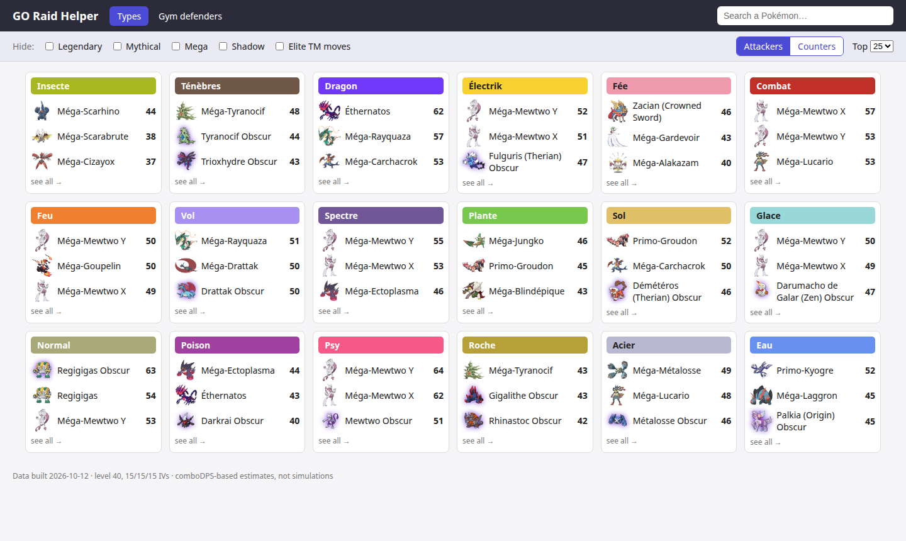
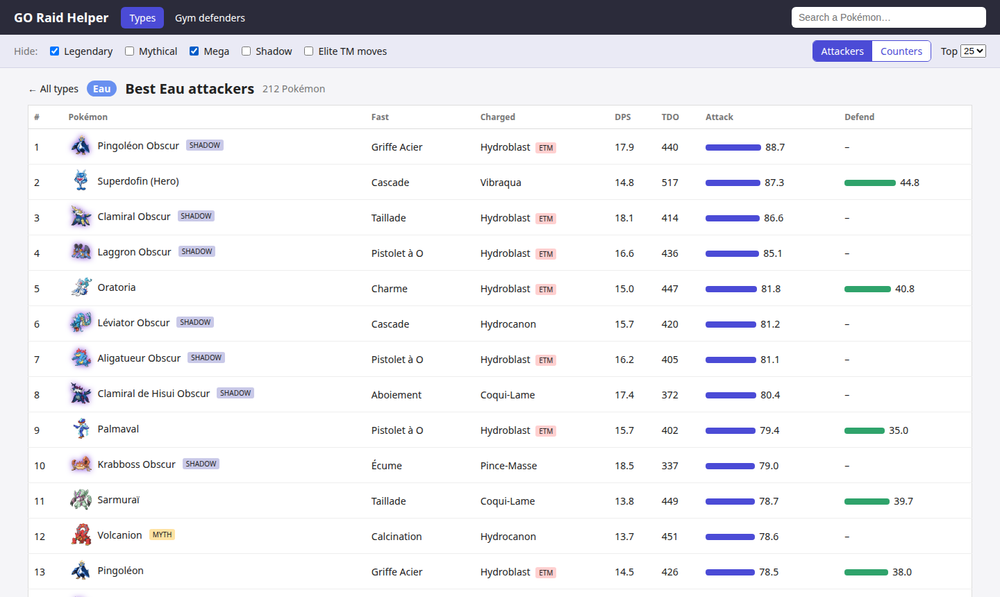
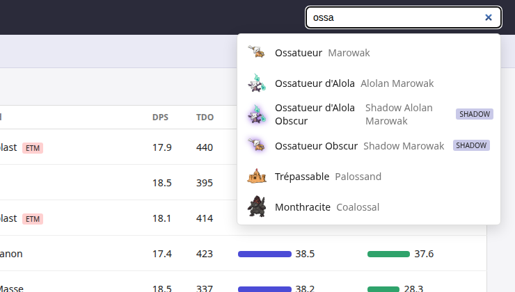
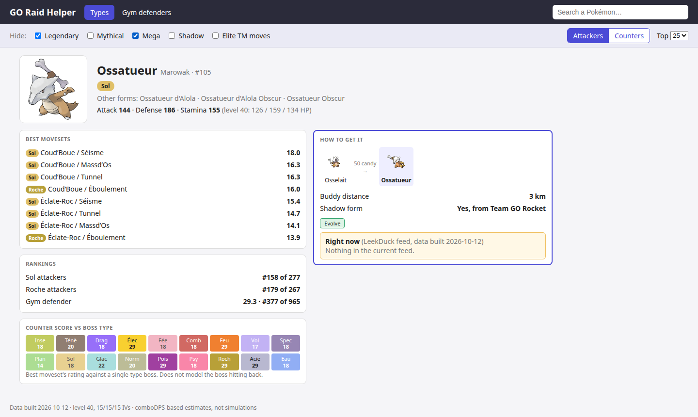
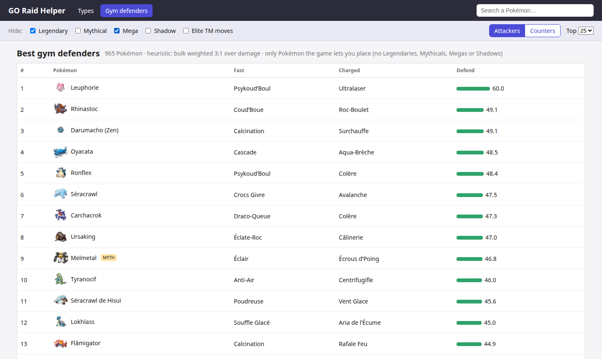

# Pokémon GO Raid Helper 🔥⚔️

> **"Is this one a keeper, or can I transfer it?"**
> One page, French names, an answer in two clicks.

My partner plays Pokémon GO. Their storage is always full, and every cleanup
turns into the same conversation: *"Is Ossatueur good? What about this Dracaufeu? Do I
keep the shiny one or the one with better stats?"* The answers exist, but they're spread
across English-only sites full of ads, tabs and acronyms.

So this is a tiny, friendly, **French-first** page that answers it quickly:

- 🗂️ **Browse by type.** All 18 types on one screen with the top 3 of each and their sprites.
  Click a type to see the full ranking.
- 🔍 **Search any Pokémon** in French or English. "Dracaufeu" and "Charizard" both work.
- ⭐ **See its rating at a glance.** Its best moves, where it ranks for its type, and whether it's
  worth leaving in a gym.
- 🥚 **Find out how to get it.** The evolution line with candy costs, the buddy distance, whether a
  shadow or Mega exists, and what's **in raids, eggs or research right now**.
- 🎚️ **Filter to what you actually own.** Hide Legendaries, Mythicals, Megas, Shadows or
  Elite-TM moves, and the rankings recompute instantly.

The rule of thumb: **if it shows up near the top of a type you raid with, keep it.**

## 👉 Open it: https://arthurg-data.github.io/pokemon-go-ranking/

Bookmark it on your phone. The data rebuilds every morning, so *Right now* always shows the current raids, eggs and research.

## How to use it: the storage-cleanup routine

**1. Set the filters to match your collection.** No Legendaries in the box? Tick *Legendary*.
No Mega Energy? Tick *Mega*. Every list then shows only Pokémon you could actually own.

**2. Look at the types you raid with.** The landing page shows the top 3 for every type.



**3. Open a type to see the full ranking.** Here are the Water attackers with Legendaries and Megas hidden.
Each row shows the best moveset, an *ETM* badge if that moveset needs an Elite TM, the attack score and the gym score.



**4. Not sure about one Pokémon? Search it.** French or English, with or without accents.



**5. Read its card and decide.** Ossatueur (Marowak) ranks **#158 of 277** Ground attackers and #377 of 965 as a gym defender.
**That's a transfer.** The *How to get it* box also tells you it takes 50 Osselait candy, and that there's a shadow
version from Team GO Rocket if you want a stronger one later.



**Bonus: find what to leave in gyms.** The *Gym defenders* tab ranks the bulkiest Pokémon you can place.



## Why it's fun

- 🧮 **The numbers are real.** Ratings are computed from the game's own data file (the
  "Game Master") with the community's standard DPS / TDO formulas. They aren't copied from a site.
- 🇫🇷 **Everything is in French.** Pokémon and moves use their official French names,
  so *Rafale Feu* and *Danse Flammes*, never "Blast Burn".
- 🌍 **It stays current.** One command re-downloads the game data and the live event feed.
- 🪶 **It's tiny.** A Python script builds one JSON file, and a single HTML page reads it.
  No server, no framework, no account.

## 🤖 100% vibe coded

Every line here was written by Claude (Claude Code), from brainstorming and mockups
to the spec, the plan, the code and the tests. The human described what their partner needed,
picked between options, and said "looks good!". The design notes and plan it worked from are in
[`docs/superpowers/`](docs/superpowers/).

It still has real tests: 51 of them, including a headless-browser check of the page.

## Run it locally

You only need this to work on the code. Everyone else can use the link above.

```bash
uv sync
uv run python -m pipeline.build        # downloads the data (cached 24h) and writes web/data.json
python3 -m http.server -d web 8000     # then open http://localhost:8000
```

`--force` re-downloads everything, and `--no-fetch` rebuilds offline from `data/raw/`.

## How the ratings work

The rule of thumb above rests on two scores.

- **Attack.** Each Pokémon is scored at level 40 with perfect IVs. The score is `(DPS³ × TDO)^¼` from
  the comboDPS formula, against a reference boss with defense 180.
  - **Attackers** of a type are Pokémon whose charged move is of that type.
  - **Counters** to a type apply type effectiveness against a boss of that type.
- **Defend.** This is a gym heuristic: `(HP × defense)^0.75 × DPS^0.25`, so bulk matters more than damage.
  Only Pokémon the game lets you place in a gym get one. Legendaries, Mythicals, Ultra Beasts, Megas and Shadows
  can't defend, so they show a dash.

These are estimates to help you decide what to keep, not battle simulations.

## Data sources

| Source | Used for |
|---|---|
| [PokeMiners Game Master](https://github.com/PokeMiners/game_masters) | stats, moves, forms, type chart |
| [PokeAPI](https://github.com/PokeAPI/pokeapi) CSVs and sprites | French and English names, images |
| [ScrapedDuck](https://github.com/bigfoott/ScrapedDuck) (LeekDuck feed) | current raids, eggs and research |

Pokémon and Pokémon GO are trademarks of Nintendo, The Pokémon Company and Niantic.
This is an unofficial fan project.

## Tests

```bash
uv run pytest                           # unit tests and browser tests
uv run playwright install chromium      # once, for the browser tests
uv run python scripts/make_fixtures.py  # regenerate test fixtures after a Game Master update
```
